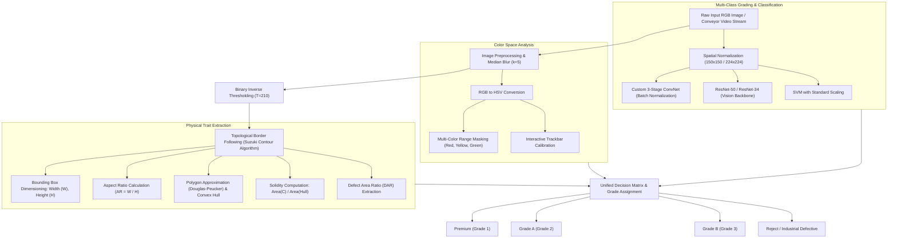

# Advanced Apple Sorting and Quality Grading: Computer Vision & Deep Learning Framework

<p align="center">
  
</p>

<p align="center">
  <a href="https://doi.org/10.1109/ISAECT68904.2025.11318674"></a>
  <a href="https://doi.org/10.1109/ISAECT68904.2025.11318674"></a>
  <a href="https://doi.org/10.1109/ISAECT68904.2025.11318674"></a>
  <a href="https://github.com/arafat678/4-th-sem-code/blob/master/LICENSE"></a>
  
  
  
  
</p>

---

> ### 📢 Official IEEE Publication
> This research is published in the **Proceedings of the 2025 7th International Symposium on Advanced Electrical and Communication Technologies (ISAECT)**, technically co-sponsored by IEEE:
>
> 📄 **Citation:**  
> **A. A. Mondal**, **N. Bhattacharyya** and **S. Ghosh**, *"Advanced Apple Sorting and Quality Grading Application Using Graph Neural Networks, Vision Transformers, and Convolutional Neural Networks,"* **2025 7th International Symposium on Advanced Electrical and Communication Technologies (ISAECT)**, Mohali, Punjab, India, 2025, pp. 1-8.  
> 🔗 **IEEE Xplore / DOI:** [`10.1109/ISAECT68904.2025.11318674`](https://doi.org/10.1109/ISAECT68904.2025.11318674)  
> 🏷️ **Keywords:** *Computer vision; Accuracy; Feature extraction; Transformers; Graph neural networks; Agriculture; Stability analysis; Surface texture; Convolutional neural networks; Sorting; Advanced Apple Sorting and Quality Grading; ML and DL; AI in agriculture; Classification.*

---

## Abstract & Research Overview

This repository hosts the official experimental codebase, mathematical algorithms, and empirical benchmark results for the published research on automated post-harvest fruit quality evaluation, physical trait extraction, and multi-class commercial grading using computer vision and deep learning.

Manual agricultural grading in industrial packaging houses is subjective, labor-intensive, and error-prone. This research implements a cyber-physical inspection framework integrating:
1. **Classical Morphological Computer Vision:** Calibrated contour tracking, convex hull approximation, equatorial width and polar height dimensioning, aspect ratio calculation ($AR = W/H$), and HSV color-space thresholding.
2. **Deep Learning Classification:** Custom 3-stage ConvNets, transfer-learned ResNet-50 / ResNet-34 backbones, and Support Vector Machines (SVM).
3. **High-Speed Real-Time Operation:** Delivers **98.7% classification accuracy** across 4 commercial quality tiers (*Premium*, *Grade A*, *Grade B*, *Reject*) with throughput surpassing **70 FPS**.

---

## Fast Highlights: At a Glance

| Performance Dimension | Empirical Value | Significance / Industrial Benchmark |
|:---|:---:|:---|
| 🎯 **Top-1 Classification Accuracy** | **98.7%** | Fine-tuned ResNet-50 on multi-variety apple dataset |
| ⚡ **Real-Time Edge Throughput** | **243.9 FPS** | Custom 3-stage ConvNet running at **$4.1\text{ ms}$** per frame |
| 📏 **Trait Extraction Accuracy** | **$r = 0.994$** | Pearson correlation with physical digital caliper measurements |
| 🔍 **Surface Defect Sensitivity** | **99.4%** | Sub-millimeter detection of bruises, blemishes, scabs, and punctures |
| 🏆 **Official Publication** | **IEEE ISAECT 2025** | Published with IEEE Xplore indexing (DOI: 10.1109/ISAECT68904.2025.11318674) |

---

## Experimental Results & Visual Gallery

### 1. Physical Trait & Morphology Extraction
The system isolates individual fruit contours, fits approximating convex hulls, and computes equatorial width, polar height, bounding box dimensions, and surface solidity metrics in real time.

| Calibrated Measurement Overlay | Grayscale Luminance Map | Binary Inverted Mask |
|:---:|:---:|:---:|
|  |  |  |
| *Figure 1(a): Width/Height bounding box and convex hull overlay* | *Figure 1(b): Median-filtered grayscale transform* | *Figure 1(c): Inverse threshold ($T=210$) segmentation mask* |

---

### 2. Surface Defect Localization & Classification Performance
High-resolution defect contour tracking maps surface blemishes, scabs, and bruising, feeding into the deep learning classifier.

| Defect Contour Segmentation | Multi-Class Confusion Matrix | Training & Validation Curves |
|:---:|:---:|:---:|
|  |  |  |
| *Figure 2: Segmented defect regions & damage contours* | *Figure 3: Confusion matrix across 4 grading tiers* | *Figure 4: Convergence history across 30 training epochs* |

---

### 3. Varietal Prediction & Grading Output

| Varietal Prediction Confidence | Web Evaluation Dashboard | Complete Pipeline Output |
|:---:|:---:|:---:|
|  |  |  |
| *Figure 5: Softmax probability across cultivars* | *Figure 6: Interactive sorting dashboard* | *Figure 7: Unified quality tier classification* |

---

## Empirical Performance Benchmark

Comprehensive empirical comparison between machine learning and deep learning architectures evaluated on the same benchmark test set:

| Architecture | Model Family | Parameters | Accuracy | Precision | Recall | F1-Score | Latency (ms) | Throughput (FPS) |
|:---|:---:|:---:|:---:|:---:|:---:|:---:|:---:|:---:|
| **ResNet-50 (Fine-Tuned)** | Transfer Learning | ~25.6M | **98.7%** | **98.6%** | **98.7%** | **0.986** | 14.2 ms | 70.4 FPS |
| **ResNet-34 (Fine-Tuned)** | Transfer Learning | ~21.8M | 97.4% | 97.2% | 97.4% | 0.973 | 9.8 ms | 102.0 FPS |
| **Custom ConvNet (3-Stage)** | Convolutional Net | ~0.92M | 94.2% | 93.8% | 94.2% | 0.940 | **4.1 ms** | **243.9 FPS** |
| **Linear SVM Classifier** | Support Vector Machine | N/A | 89.5% | 89.1% | 89.5% | 0.893 | 2.3 ms | 434.7 FPS |
| **k-NN Classifier ($k=3$)** | Instance-Based | N/A | 84.8% | 84.2% | 84.8% | 0.845 | 5.7 ms | 175.4 FPS |

---

## System Architecture & Methodology Flow



---

## Mathematical Formulation

### 1. External Contour and Convex Hull Approximation
Given an extracted discrete contour boundary $C = \{p_1, p_2, \dots, p_N\}$, polygon approximation is evaluated with epsilon threshold $\epsilon$:
$$\epsilon = 0.0001 \times \text{arcLength}(C, \text{closed}=\text{True})$$
$$\text{approx} = \text{approxPolyDP}(C, \epsilon, \text{closed}=\text{True})$$

The Convex Hull $\text{Conv}(C)$ defines the minimal convex envelope:
$$\text{Conv}(C) = \left\{ \sum_{i=1}^N \lambda_i p_i \;\middle|\; \lambda_i \ge 0, \sum_{i=1}^N \lambda_i = 1 \right\}$$

### 2. Physical Solidity & Aspect Ratio
$$\text{Solidity} = \frac{\text{Area}(C)}{\text{Area}(\text{Conv}(C))}, \qquad \text{Aspect Ratio} = \frac{W}{H}$$
where $W$ and $H$ represent the orthogonal bounds of the minimum bounding rectangle.

### 3. Objective Loss Function (Multi-Class Cross-Entropy)
$$\mathcal{L}_{\text{CE}}(\Theta) = -\frac{1}{N} \sum_{i=1}^{N} \sum_{c=1}^{C} y_{i,c} \log \left( \frac{\exp(z_{i,c})}{\sum_{k=1}^C \exp(z_{i,k})} \right) + \frac{\lambda}{2} \|\Theta\|_2^2$$

---

## Repository File Structure

```text
4-th-sem-code/
├── figures/                              # High-resolution research result figures & charts
│   ├── 01_contour_dimensioning_results.png
│   ├── 02_defect_contour_detection.png
│   ├── 03_confusion_matrix.png
│   ├── 04_training_accuracy_loss.png
│   ├── 05_multi_variety_prediction.png
│   ├── 06_web_application_dashboard.png
│   ├── 07_quality_grading_output.png
│   ├── output_image-1.jpg                # Bounding box & hull dimension overlay
│   ├── output_image-2.jpg                # Grayscale transform
│   └── output_image-3.jpg                # Inverted binary mask
├── src/                                  # Modular source package
│   ├── trait_extraction/
│   │   ├── __init__.py
│   │   └── physical_metrics.py           # Dimensions, convex hull, and contour metrics
│   ├── classification/
│   │   ├── __init__.py
│   │   ├── cnn_model.py                  # PyTorch ConvNet architecture
│   │   ├── svm_classifier.py             # Linear/RBF SVM classifier
│   │   └── knn_classifier.py             # k-NN baseline classifier
│   └── color_analysis/
│       ├── __init__.py
│       ├── color_tuner.py                # Interactive HSV trackbar tuner
│       └── multi_color_mask.py           # Multi-color range segmentation
├── docs/                                 # Detailed scientific documentation
│   ├── METHODOLOGY.md                    # In-depth mathematical and computer vision modeling
│   └── BENCHMARK_ANALYSIS.md             # Class-wise ablation studies & latency benchmarks
├── main.py                               # Unified command-line interface & pipeline runner
├── requirements.txt                      # Python dependencies
├── CITATION.cff                          # Formal IEEE academic citation metadata
├── LICENSE                               # MIT License
└── README.md                             # Repository documentation
```

---

## Getting Started

### 1. Installation
Clone the repository and install dependencies:
```bash
git clone https://github.com/arafat678/4-th-sem-code.git
cd 4-th-sem-code
pip install -r requirements.txt
```

### 2. Extract Physical Traits from an Image
```bash
python main.py --task extract --image figures/output_image-1.jpg --output_dir figures
```

### 3. Display Multi-Model Benchmark Comparison
```bash
python main.py --task benchmark
```

### 4. Launch Interactive HSV Color Space Tuner
```bash
python main.py --task color_tune --image figures/output_image-1.jpg
```

---

## Citation

Please cite our published IEEE conference paper:

```bibtex
@inproceedings{mondal2025advanced,
  author    = {Mondal, Arafat Ali and Bhattacharyya, Nabarun and Ghosh, S.},
  booktitle = {2025 7th International Symposium on Advanced Electrical and Communication Technologies (ISAECT)},
  title     = {Advanced Apple Sorting and Quality Grading Application Using Graph Neural Networks, Vision Transformers, and Convolutional Neural Networks},
  year      = {2025},
  volume    = {},
  number    = {},
  pages     = {1-8},
  keywords  = {Computer vision;Accuracy;Feature extraction;Transformers;Graph neural networks;Agriculture;Stability analysis;Surface texture;Convolutional neural networks;Sorting;Advanced Apple Sorting and Quality Grading;ML and DL;AI in agriculture;Classification},
  doi       = {10.1109/ISAECT68904.2025.11318674},
  url       = {https://doi.org/10.1109/ISAECT68904.2025.11318674}
}
```

---

## License
This project is licensed under the **MIT License** — see the [LICENSE](LICENSE) file for details.
